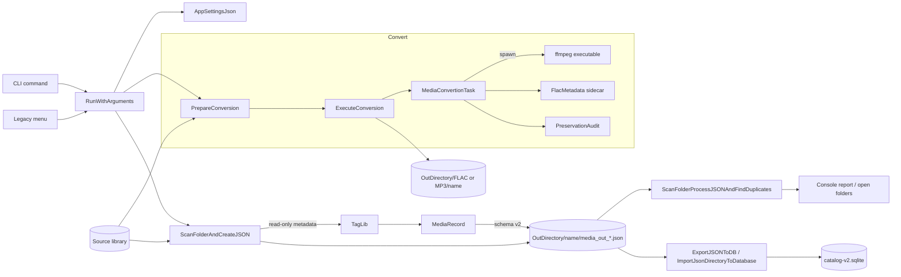

# FlacConvert design

What the application is: components, flows, contracts and file formats. Rules for changing it live in
`.github/instructions/`; the reasons behind decisions live in `docs/knowledge/` (K-xxx); user-visible features are
tracked in `docs/features/`. Code is cited as `path#Symbol`.

## Purpose

`FlacConvert` is a console utility for a local music library. It:

- converts audio to a separate output tree (16-bit / 44.1 kHz FLAC, or FLAC to MP3) without touching sources;
- scans libraries into JSON metadata batches;
- finds probable duplicate albums from those batches;
- imports the batches into a per-library SQLite database.

It runs either as explicit CLI commands or, with no arguments, as a legacy interactive menu.

## Component map

| Component | Files | Responsibility |
|---|---|---|
| Entry and orchestration | `src/FlacConvertMain.cpp` | `wmain`/`main` → `RunWithArguments`; CLI dispatch; `RunLegacyMenu` (menu, previews, `RUN` confirmation, `ManualOperationSummary`); scan, duplicate and DB-import flows |
| CLI parsing | `src/CommandLine.cpp`, `include/CommandLine.h` | `ParseCommandLine` (CLI11) → `CommandLineOptions` |
| Configuration | `src/AppSettings.cpp`, `include/AppSettings.h` | `AppSettingsJson` load/save, defaults, process-wide instance; `MediaDirectoryElement` output naming |
| Conversion options | `include/ConversionOptions.h` | `AudioTarget` (Flac/Mp3), MP3 quality, downmix flag |
| Folder conversion | `src/FolderConvert.cpp`, `include/FolderConvert.h` | `FolderConvert::PrepareConversion` (plan) and `FolderConvert::ExecuteConversion` (run, audit report, markers) |
| File conversion | `src/MediaConvertionTask.cpp`, `include/MediaConvertionTask.h` | `MediaConvertionTask`: quality gate, FFmpeg child process, output verification, sidecar, audit, installation |
| Metadata archive | `src/FlacMetadata.cpp`, `include/FlacMetadata.h` | `FlacMetadata::Save` / `FlacMetadata::Verify` byte-exact archive as binary `.flac-metadata` or `.flac-metadata.json` (readable scan-schema metadata + Base64 archive; only the archive is verified) |
| Preservation audit | `src/PreservationAudit.cpp`, `include/PreservationAudit.h` | `PreservationAudit::Compare` (tags, pictures, chapters, opaque blocks), `PreservationAudit::VerifyCopy` |
| FFmpeg library access | `src/ffmpeg.cpp`, `include/ffmpeg.h`, `include/FFmpegWrapper.h` | `FFmpeg::GetFFprobeMetadataAPI` (conversion/duplicate re-probes) and the process-wide log callback |
| Catalog metadata | `src/TagLibReader.cpp`, `include/TagLibReader.h`, `include/MediaRecord.h`, `src/MediaRecordJson.cpp` | Read-only TagLib extraction, normalized multi-value tags, source-scoped raw tags, picture descriptors, and schema-v2 JSON |
| Track/album model | `src/MediaTrack.cpp`, `include/MediaTrack.h`, `include/MediaInformation.h`, `include/MediaAlbum.h` | `MediaTrack` (legacy probe parsing/comparison), `FFprobeOutput`, `MediaAlbum` |
| Catalog database | `src/CatalogDatabase.cpp`, `include/CatalogDatabase.h` | Schema-v2 SQLite writer, stable library-relative identity, incremental upsert and stale-file cleanup |
| Album collection | `src/AlbumCollection.cpp`, `include/AlbumCollection.h` | Discovery (`AlbumCollection::LoadAlbumsCo`), metadata import/cache reuse, JSON save/load, duplicate search, `AlbumCollection::ExportToDatabase` |
| Platform adapters | `src/PlatformUtils.cpp`, `include/PlatformUtils.h` | UTF-16/UTF-8, `PlatformUtils::WindowsLongPath`, `PlatformUtils::OpenDirectory` |
| Utilities | `src/CommonUtils.cpp`, `include/CommonUtils.h`, `include/BoundedTaskRunner.h`, `src/JsonUtils.cpp`, `include/JsonUtils.h` | UTF-8 path helpers, coroutine `Generator`, bounded task runner, JSON helpers |
| Legacy (unused) | `FolderConvert::ConverAudioFolder`, `FolderConvert::ConverAudioFolder2`, `MediaConvertionAsyncTask` | In-place conversion paths with no caller outside themselves; not part of any current flow |

## Data flow

## Entry points

| Mode | Entry | Notes |
|---|---|---|
| `convert <input> [--to flac\|mp3] [--mp3-quality 0-9] [--downmix-to-stereo] [--overwrite] [--no-metadata-sidecar] [--output-dir]` | `RunWithArguments` → `FolderConvert::ConvertAudioFolderToOutput` | Output `<root>/<FLAC\|MP3>/<input folder name>` (K-031); `--no-metadata-sidecar` is valid only for an `optional` sidecar policy (K-038) |
| `scan <library> [--output-dir] [--full-rescan] [--tier catalog\|integrity\|analysis]` | `ScanFolderAndCreateJSON` | One library; name = folder name |
| `duplicates <json dir> [--open]` | `ScanFolderProcessJSONAndFindDuplicates` | Opens folders only with `--open` |
| `db import <json dir> [--output-dir]` | `ImportJsonDirectoryToDatabase` | `<output root>/<JSON folder name>/catalog-v2.sqlite`; output root is `--output-dir`, else `OutDirectory` |
| No arguments | `RunLegacyMenu` | Options 1 FLAC, 2 scan, 3 duplicates, 4 DB import, 5 not implemented, 6 MP3; all use active `MediaDirectoryList` entries |

All commands accept `--config <file>`. Exit code is 0 on success, non-zero on any failure.

## Key flows

### Conversion (menu 1/6, `convert`)

1. **Plan** – `FolderConvert::PrepareConversion` resolves input/output, rejects source/output overlap and reserved
   state names, enumerates source entries once, classifies convertible audio (`MediaTrack::IsFileConvertable`), maps files to
   `<output>/<relative path>` with a unique temporary (`.afc-convert-<pid>-<time>-<n><ext>`), and records existing
   targets and case-insensitive collisions, including file/directory collisions. FLAC counts files, audio and
   conversions per source subtree. The topmost subtrees with audio but no conversions are skipped and recorded in
   `FolderConversionPlan::skippedDirectories`; a library without conversions skips its root (`"."`) and writes only
   the report. Every other directory is retained and every other regular file is copied, including unsupported
   audio beside conversions and folders without audio (K-036). Directory links and non-regular entries fail FLAC
   planning anywhere, including inside skipped subtrees, rather than disappearing from output. MP3 mode retains its
   non-audio companion policy, skips non-FLAC audio and does nothing without convertible FLAC. Nothing is written.
2. **Preview** (menu only) – `ConvertConfiguredLibraries` plans *all* active libraries, checks cross-library overlap,
   prints `ShowConversionPreview`, and requires `RUN` (`ConfirmPreview`). Any conflict blocks the whole run (K-027).
3. **Execute** – `FolderConvert::ExecuteConversion` creates the library folder (ownership = created by this run),
   creates the `.conversion-in-progress` marker directory, then processes audio files sequentially:
   `MediaConvertionTask::Run` (convert + verify + audit) then `MediaConvertionTask::PostRun` (install). Retained FLAC
   output directories, including empty ones, are created; skipped folders are logged and never created.
   Unchanged file copies (internally `companions`, including unsupported audio for FLAC) are
   copied to a temporary, verified byte-for-byte (`PreservationAudit::VerifyCopy`) and installed.
4. **Finish** – re-checks every installed file, directory and sidecar (`FlacMetadata::Verify`). The report uses a
   verified temporary and the same output installer. Writes `conversion-audit.json`,
   removes the marker. On failure the report is written, an owned folder is renamed with an error prefix, and the
   marker is retained (K-030).

Per file, `MediaConvertionTask::ConvertFile`:

1. probes the source (`FFmpeg::GetFFprobeMetadataAPI`) and rejects it below 16-bit / 44.1 kHz or if required
   properties are unverifiable (`isAtLeastCDQuality`, K-048). AAC bypasses only the bit-depth check because its
   encoded stream does not establish source PCM depth; it still requires a verified rate of at least 44.1 kHz and
   emits a lossy-conversion warning. MP3 also requires FLAC codec and mono/stereo unless downmix is enabled (K-016);
2. rejects destinations that alias the source or pre-existing temporaries;
3. for MP3 or native FLAC sources (`FlacMetadata::AppliesTo`), writes and verifies a metadata sidecar to a
   temporary when the run's `ConversionOptions::sidecarFormat` is not `None` (K-038); with format `None` it
   only prepares a clean input when appended tags must be removed;
4. runs `ffmpeg` via `runFFmpeg` with `conversionArguments` (K-014, K-017);
5. verifies output codec, rate, depth/channels and duration (±0.15 s);
6. verifies the archive again (when written) and runs `PreservationAudit::Compare` (K-029); without an archive,
   differences that would otherwise be `SidecarOnly` are fatal (fail-closed).
   For MP4-family sources, container descriptors (`major_brand`, `minor_version`, `compatible_brands`) and
   FFmpeg's default stream tags (`handler_name=SoundHandler`, `language=und`, `vendor_id=0x0000`) are treated as
   generated metadata rather than user-tag losses.

**Sidecar policy.** `MetadataSidecarSettings::Resolve` turns the configured `MetadataSidecars` policy for the target
(`ConvertToFlac` / `ConvertToMp3`) and the run's disable request into the effective format: `disabled` (default) → none;
`optional` → `Format` unless the menu prompt answers NO or the CLI passes `--no-metadata-sidecar`; `required` →
`Format`, and a CLI disable request is a configuration error. Menu options 1 and 6 and CLI `convert` resolve it
before planning; scan, duplicates and DB import never write sidecars. `conversion-audit.json` is always written and
records the effective `metadataSidecars` value.

`MediaConvertionTask::InstallTemporaryOutput` installs the sidecar first (backing up an existing one when
overwriting), then the audio; on audio failure it restores or removes the sidecar and leaves the temporary in place
(K-041).

### Scan to JSON (menu 2, `scan`)

`ScanFolderAndCreateJSON`: discover albums (including files directly under the library root) in batches of
`AlbumsSplitThreshold` (`AlbumCollection::LoadAlbumsCo`), reuse prior records for unchanged `(path, size, full-precision mtime)`
when `Incremental=true` (unless CLI `--full-rescan` is specified), recompute album-level findings from current tracks,
read remaining accepted formats from `CatalogExtensions` with `TagLibReader`, then read container chapters through
the linked FFmpeg libraries
(`AlbumCollection::ImportMetadata`, optionally using bounded workers controlled by `UseAsyncMetadataReads`),
sort by normalized album artist, write schema-v2 records to a staging sibling directory
(`AlbumCollection::SaveAlbumsToJSON`), then `installGeneratedFiles` swaps only `media_out_*.json` files into
`OutDirectory/<mediaName>/`, with backup and rollback (K-005). records keep normalized multi-value tags separate
from source-scoped raw tag entries and include technical properties, picture descriptors, and explicit
support/analysis statuses; chapter boundaries and chapter tags come from libavformat. FLAC and MP3 native inventories
are partial; other configured formats expose TagLib properties while `support.nativeInventory` remains `unsupported`.
Tag validation records missing title/artist/album tags, malformed track/disc numbers, non-ISO dates, malformed
MusicBrainz UUIDs, ISRCs and EAN/UPC/GTIN check digits, and album-level inconsistencies for album, album artist,
release date, and label. Album validation also flags duplicate/gapped per-disc track numbers and inconsistent or
mismatched declared track/disc totals without treating the folder as proof of album completeness.
Unavailable properties are omitted, including unknown FLAC STREAMINFO sample counts and MD5 signatures.
An inaccessible discovered directory, an output write/close error, or an accepted audio track with a read/JSON error or
without usable sample-rate/channel data fails the scan before installation, preserving the prior generated JSON
(K-035). TagLib reads use a read-only stream. The menu preview discovers albums without reading track metadata and
reuses the discovered batches. `ScanTier` selects `catalog` (default), `integrity`, or `analysis`; CLI `scan --tier`
overrides the config. Integrity and analysis tiers decode the audio once, report decode/sample/hash results, and
analysis adds per-channel signal statistics and zero-padded-hi-res findings. Decode failures are retained in the
record without discarding successfully read tags. Each scan writes `scan-report.json` beside the generated batches with run status, duration, structured diagnostics,
and distinct discovered, serialized, staged, and installed counts. Filesystem exceptions include their affected path
when supplied; accepted audio paths are also linked as track paths. FFmpeg warnings/errors without a thread-local
file capture are recorded at scan scope, never guessed to belong to a track. Record-level non-fatal diagnostics
remain in the corresponding catalog record; a failed scan writes the report separately without installing staged
catalog JSON. The report contract is
`docs/schemas/scan-report-v1.schema.json`. `ExtraAudioQualityMetrics` is deprecated and ignored.
Batching remains album-count based (`AlbumsSplitThreshold`), not serialized-size based. Failures before safe output
path validation, or failures that prevent writing the report itself, are visible only through the application log.

### Duplicates (menu 3, `duplicates`)

`ScanFolderProcessJSONAndFindDuplicates`: load all batches, sort by track count, `AlbumCollection::FindDuplicateAlbums`
(track count, album identity, then sorted durations within the legacy `SizeMatchPercentageThreshold` percentage).
Album artist tags form the artist identity when present; otherwise the set of track artists is used. It pairs
cataloged tracks in scanned duration/title order and re-probes those paths in parallel before printing a
stream-property and tag comparison (`MediaTrack::GenerateComparisonReport`). Missing tracks retain their positions;
new immediate files are reported but not substituted. For v2 records, changed size or available modification time
is reported, but these attributes cannot prove file identity; legacy records lack this check and candidate selection
still reflects the scan. Probe errors fail the operation.
The operation is read-only; folders are opened only when requested.

### Database import (menu 4, `db import`)

`ExportJSONToDB` (menu, per library, all JSON batches in one transaction) or `ImportJsonDirectoryToDatabase` (CLI,
one transaction): `CatalogDatabase::Import` writes catalog schema v2 to
`OutDirectory/<name>/catalog-v2.sqlite`, leaving any prior `.db` database untouched. File identity is
`(library_id, relative_path)` (K-040); records upsert without duplicating files, and missing tracks are deleted only from
albums included in the import. Albums absent from the import remain untouched. Imports require schema-v2 JSON with a
consistent `"Library Root"`; database paths inside that library are rejected before directory creation. Existing
version-2 databases must have the application-defined table and view definitions; incompatible databases are rejected
before catalog writes. The transaction
includes all imported albums and rolls back completely on any failure. `schema_docs`, `enum_docs`, and
`catalog_meta.ai_guide` describe the schema and safe interpretation of measured versus claimed data.
CLI import reads through the supplied directory path and names the output after that directory, without resolving
directory aliases; a trailing separator does not change the name.

### Output-directory anchoring

`PlatformUtils::ScopedCurrentDirectory` validates that an output root does not overlap its source before creating or
installing files. For Windows targets shorter than `MAX_PATH - 64`, it enters the output directory so renames cannot
redirect the active operation. Near-limit and longer Windows paths use a short ancestor, open each directory
from that anchor with delete-sharing disabled, validates the opened directory's resolved path, and exposes absolute
extended paths through `ResolvePath`; filesystem paths receive the `\\?\` prefix at the Windows directory path
limit (`MAX_PATH - 12`). Conversion, scan installation, and catalog publication use these resolved
paths and check `IsAnchored` before finalizing. Windows working-directory changes and restoration use ordinary
drive/UNC paths, not the extended prefix: legacy FFmpeg launchers such as Chocolatey's .NET shim reject an inherited
`\\?\` working directory. File I/O retains extended-path support. `Restore` releases the directory locks before an
owned failed conversion folder is renamed, preserving the ownership and marker behavior in K-030.
`tests/scoped_current_directory.cpp` checks long-path anchoring and rename denial; generated conversion, scan, and
database integration fixtures cover the corresponding output paths.

## Contracts and invariants

- **Sources must never be modified.** Every write target must be outside the source tree; overlap is rejected at
  plan time and revalidated against the directory actually opened by the shared output anchor. The anchor prevents
  the output path or its ancestors from being renamed into a source-library link while conversion, scan installation,
  or catalog publication is active (K-047 fixed).
- **Install only after success.** Output is written to a unique temporary, verified and audited, then moved into place
  (`installFile`: `MoveFileExW` on Windows; rename or hard-link/copy elsewhere). Without overwrite an existing
  target is never replaced (K-041).
- **Configured paths for I/O, canonical paths for safety checks only** (K-032). Known exception:
  `ConvertConfiguredLibraries` validates each library with `fs::is_directory` on its canonical path.
- **Processing is sequential and stops at the first error**; earlier outputs remain; no batch rollback (K-024).
- **Ownership:** only library folders created by the current execution are renamed on failure (K-030).
- **Reserved names:** `conversion-audit.json` and `.conversion-in-progress` at a library root; a source containing
  either name in any letter case blocks the run on every platform; an existing in-progress marker in the output
  blocks reuse.
- **FLAC completeness:** every written folder is complete: each enumerated regular file outside a skipped subtree is
  converted or copied, and each directory outside it is retained. Skipped subtrees (audio, no conversions) are
  omitted entirely and listed in the report. Unsupported filesystem entries or filename collisions fail rather than
  being silently omitted.
  Regular-file symlinks are read as content, not reproduced as links. Plans are preview-time snapshots, not
  transactional filesystem snapshots; unrelated existing output files are not deleted.
- **External FFmpeg tools are child processes with argument vectors**, never shell commands (K-014).
  Catalog scans and duplicate-report re-probes use TagLib and linked FFmpeg libraries; the ffprobe executable is not
  used for metadata extraction.
- **Counts reflect confirmed work only** (installed files, installed JSON batches, committed DB batches, processed
  duplicate pairs) (K-024).

## Configuration

`AppSettingsJson::LoadForCommandLine` order: `--config` → directory persisted in `AppSettingsJsonPersistent.txt`
(current directory) → `./config.json` → built-in defaults (`AppSettingsJson::GetDefaultSettings`, no libraries). The
legacy menu uses `AppSettingsJson::AppSetting`, which can prompt for a config directory and offer to create one.

| Key | Default | Used by |
|---|---|---|
| `OutDirectory` | `C:\tmp` (Windows) / temp dir (K-007) | All outputs |
| `LogLevel` | 1 (0–6, spdlog levels) | Logger |
| `UseAsyncMetadataReads` | true | Parallel TagLib scan reads; legacy `UseAsyncFFmpegCalls` is accepted as an alias |
| `Incremental` | true | Reuse scan records when library-relative file path, size and modification time match and the cached tier is the requested tier or higher (`AlbumCollection::ImportMetadata`) |
| `ScanTier` | `catalog` (`catalog`\|`integrity`\|`analysis`) | Default scan tier; CLI `scan --tier` overrides it |
| `MetadataScanMaxThreads` | 0 (automatic) | Maximum per-album metadata workers; 0 uses hardware concurrency, falling back to 4 |
| `DecodeWorkers` | 0 (automatic) | Independent full-decode worker cap; 0 uses at most 4 workers and half the available hardware concurrency |
| `CatalogExtensions` | `[".flac", ".mp3"]` | Accepted scan formats; additional TagLib formats may be enabled explicitly |
| `UseFFmpegLibraryAPI` | deprecated | Ignored with a warning; metadata re-probes always use linked FFmpeg libraries |
| `ExtraAudioQualityMetrics` | false | Deprecated; true warns and is ignored; use the `analysis` scan tier |
| `MinMatchingTracksForDuplicate`, `SizeMatchPercentageThreshold` | 1, 3 | Duplicate search |
| `RecursionDirectorySearchDepth` | 10 | Discovery |
| `AlbumsSplitThreshold` | 2000 (>0) | JSON batch size |
| `FLACSettings.ffmpeg_exe_name` | `ffmpeg` | Conversion executable; the other `FLACSettings` strings are not used at runtime |
| `MetadataSidecars.Format` | `binary` (`binary`\|`json`) | Sidecar encoding for conversions |
| `MetadataSidecars.ConvertToFlac`, `MetadataSidecars.ConvertToMp3` | `disabled` (`disabled`\|`optional`\|`required`) | Per-target sidecar policy; invalid values fail loading |
| `MediaDirectoryList[]` | – | `{ isActive, mediaPath, mediaName }`; `mediaName` must be a single directory name |

`DatabaseFileName`, `resultPath` and `dbPath` are not used for output naming.

## Files and schemas

| Artefact | Location | Writer |
|---|---|---|
| Converted audio | `<root>/FLAC\|MP3/<name>/<relative path>.flac\|.mp3` | `MediaConvertionTask` |
| Metadata sidecar | `<audio file>.flac-metadata` (binary) or `<audio file>.flac-metadata.json` (MP3 and native-FLAC sources, per `MetadataSidecars`) | `FlacMetadata::Save` |
| Unchanged file copies | Same relative path; non-converted regular files outside skipped subtrees for FLAC, non-audio companions for MP3 | `FolderConvert::ExecuteConversion` |
| Audit report | `<library output>/conversion-audit.json` | `writeAudit` in `FolderConvert.cpp` |
| In-progress marker | `<library output>/.conversion-in-progress/` (directory) | `FolderConvert::ExecuteConversion` |
| Album JSON | `OutDirectory/<name>/media_out_<name>[_<n>].json` (schema v2; see `docs/schemas/media-catalog-v2.schema.json`) | `AlbumCollection::SaveAlbumsToJSON` |
| JSON diagnostic reports | `<album json>_ffmpeg_error.json` when captured (excluded from inputs); legacy `_error.json` reports are also excluded | `AlbumCollection` |
| SQLite catalog | `OutDirectory/<name>/catalog-v2.sqlite` (`user_version=2`) | `CatalogDatabase::Import` |

**Sidecar:** original leading ID3, `fLaC` marker and every metadata block byte-for-byte, plus trailing APE/ID3v1;
no audio. Describes the source, not the output.

**`conversion-audit.json` (`schemaVersion` 1):** `source`, `output`, `target` (`FLAC`/`MP3`), `status`
(`completed`/`failed`), `errorType` (`""`, `AUDIO`, `PRESERVATION`, `COPY`, `IO`, `INCOMPLETE`), `counts`
{`plannedAudio`, `plannedCompanions`, `installedAudio`, `installedCompanions`, `skippedAudio`,
`plannedDirectories`, `skippedUnchangedDirectories`}, `skippedUnchangedDirectories[]` {`source` (relative
directory, `"."` for root), `files`, `audioFiles`}, `skippedAudio[]`,
`files[]` {`source`, `output` (relative), `kind` (`audio`/`companion`), `status`
(`not-attempted`/`failed`/`audited`/`installed`), `metadataArchive`?, `preservationChecked`, `preservationPassed`,
`resources[]` {`status`, `resource`, `name`, `detail`, `fatal`}}. Resource statuses are
`PreservationAudit::Status`: `Preserved`, `Normalized`, `SidecarOnly`, `MissingOrChanged`, `NotVerified`, `SourceOnly`.
`companion`/`*Companions` denote unchanged file copies and include unsupported audio for FLAC; MP3 still skips
other audio. Directory fields are additive version-1 fields and are empty/zero for MP3. Skipped folders are
planning results; they are listed even when the run later fails.

**Album JSON v2:** array of `{ "Album Path", "Library Root", "Folder", "Tracks": [MediaRecord] }`. Each `MediaRecord` separates
filesystem identity, available technical properties, normalized tag arrays, raw scoped tags, picture descriptors,
reader support, validation findings, and analysis status. It does not archive embedded picture bytes or claim complete native-block
inventory; `support.nativeInventory` is `partial` for FLAC/MP3. The scan accepts the configured `CatalogExtensions`
case-insensitively (default `.flac` and `.mp3`); TagLib properties are also available for explicitly enabled M4A/MP4,
Ogg/Opus, WavPack/APE, WAV and AIFF files. The scan rejects the whole batch if an accepted track cannot be serialized
as usable audio metadata.

**SQLite catalog schema v2:** normalized `libraries`, `albums`, `files`, `tags`, `raw_tags`, `pictures`, `chapters`,
`chapter_tags`, `measurements` and `findings` tables, with `v_tracks`, `v_findings` and `v_albums` views.
`files.record_json` preserves the complete schema-v2 record; file identity is `(library_id, relative_path)`.
`schema_docs`, `enum_docs` and `catalog_meta` provide queryable descriptions, units, examples and AI interpretation hints.

## Threading and process lifetime

- Conversion: single thread; one synchronous FFmpeg child at a time (`_wspawnvp(_P_WAIT)` / `fork`+`execvp`+`waitpid`).
- Metadata import: when enabled, `BoundedTaskRunner::ForEach` runs a bounded per-album set of worker threads that
  claim track indexes from an atomic counter.
  At most `min(valid tracks in album, effective worker cap)` workers run; `MetadataScanMaxThreads=0` selects hardware
  concurrency (fallback 4). Workers finish before the next album is processed, and exceptions are rethrown after joining.
  `UseAsyncMetadataReads=false` keeps TagLib scan reads sequential.
- Decode stage (`integrity`/`analysis` tiers): a separate bounded `BoundedTaskRunner` pass after the album's TagLib
  reads, capped by `DecodeWorkers` (0 = 1 worker on single-core hosts, else `min(4, hardware_concurrency/2)`).
  Decode failures are recorded in the record without discarding tags (`AlbumCollection::ImportMetadata`).
- Duplicate comparison: one `std::async` task per track, joined before the comparison is used; re-probes use libav
  and are not bounded by `DecodeWorkers` or `MetadataScanMaxThreads`.
- `FFmpeg::ffmpeg_log_callback` is process-wide and appends to a mutex-protected buffer.
- `AppSettingsJson::AppSetting` is a lazily created process-wide instance read from worker threads; initialise it
  before starting tasks.
- No daemon or background process outlives the command; a crash leaves the marker and temporaries for inspection.

## Error handling

Functions return `0`/`true` for success and log with spdlog; exceptions are caught at flow boundaries
(`RunWithArguments`, `RunLegacyMenu`, `FolderConvert::ExecuteConversion`) and turned into failure codes.
`PreservationAudit` uses an internal `ParseError` exception converted to `NotVerified`/fatal entries. A failed
conversion records its class in `MediaConvertionTask::GetFailureType`.

## Platform boundaries

Portable core with narrow conditional blocks (K-006). Windows-specific code: `wmain`, console code pages,
`PlatformUtils::WindowsLongPath`, `ScopedCurrentDirectory`'s long-path fallback (short working-directory anchor and
directory handles opened without delete sharing), `quoteWindowsArgument` + `_wspawnvp`, `MoveFileExW`,
`CompareStringOrdinal`, SQLite `win32-longpath` VFS (K-042), default `C:\tmp` (K-007). POSIX branches:
`fork`/`execvp`, rename/hard-link install, `sqlite3_open`. `JsonUtils::tryParseMember` uses the portable
`JsonUtils::caseInsensitiveEquals` helper for case-insensitive keys (K-033).

## Build and external dependencies

CMake is the shared project build (`CMakeLists.txt`, `FlacConvert/CMakeLists.txt`), with Ninja presets for native
Windows and Linux Debug/Release builds (`CMakePresets.json`). `FlacConvertCore` owns the shared implementation and
links the SQLite amalgamation, CLI11, header-only spdlog and FFmpeg; `FlacConvert` owns the executable entry point.
Windows uses MSVC and a matching shared FFmpeg SDK selected by `FFmpeg_ROOT` (default
`external/ffmpeg/ffmpeg-master-latest-win64-gpl-shared/`); CMake stages the SDK runtime DLLs beside the executable
(K-044). Linux uses pkg-config imported targets for the system FFmpeg development packages. Both platforms use the
tracked SQLite amalgamation and initialized CLI11/spdlog submodules. TagLib is fetched by CMake at a pinned
revision; ZLIB is optional in that dependency, so compressed ID3 frame support depends on build-time ZLIB
availability. Runtime conversion still requires the `ffmpeg` executable with `libmp3lame` for MP3.

`cmake --install` stages the executable; Linux links system FFmpeg libraries, while Windows installs the matched
runtime DLLs. CMake is the only build description; Visual Studio opens the CMake presets directly.

CTest registers the Python integration suite and native preservation/warning regression tests. The native tests link
`FlacConvertCore` rather than IDE-generated object files; `tests/run_native_regression.py` creates temporary audio
fixtures using FFmpeg. `tests/mp3_conversion.py` also generates disposable fixtures. See README for presets and
prerequisites. CI uses Ubuntu 24.04 and Windows runners for Debug and Release.

## Extension points

Adding an output target (`AudioTarget` value): many sites use a binary `target == AudioTarget::Mp3 ? … : …`, so a new
value silently gets FLAC behaviour unless each site is updated:

| Concern | Site |
|---|---|
| CLI choice and option validation | `CommandLine.cpp#ParseCommandLine` |
| Output tree name (`FLAC`/`MP3`) | `FlacConvertMain.cpp#RunWithArguments`, `FlacConvertMain.cpp#ConvertConfiguredLibraries` |
| Menu entry, prompts, preview text | `FlacConvertMain.cpp#GetUserAction`, `FlacConvertMain.cpp#ConfigureManualMp3`, `FlacConvertMain.cpp#ShowConversionPreview` |
| Accepted inputs, target extension, sidecar decision | `FolderConvert.cpp#FolderConvert::PrepareConversion` |
| Audit `target` value, sidecar verification | `FolderConvert.cpp#writeAudit`, `FolderConvert.cpp#FolderConvert::ExecuteConversion` |
| Encoder arguments | `MediaConvertionTask.cpp#conversionArguments` |
| Input gate, sidecar, output verification | `MediaConvertionTask.cpp#MediaConvertionTask::ConvertFile` |
| Metadata preservation rules | `PreservationAudit.cpp#PreservationAudit::Compare` |

Adding a CLI option: `include/ConversionOptions.h#ConversionOptions`, `CommandLine.cpp#ParseCommandLine`, the menu
prompt, and `ShowConversionPreview`.

## Knowledge links

Conversion safety: K-041, K-048, K-014, K-029, K-030, K-032, K-038. Formats: K-016, K-017, K-031. Manual menu: K-024, K-025, K-026, K-027. Catalog/DB: K-005, K-042, K-040. Platform/build: K-006, K-007, K-043, K-044, K-033.
Only live entries are listed; superseded history is in `docs/knowledge/index.md` under "Closed".
