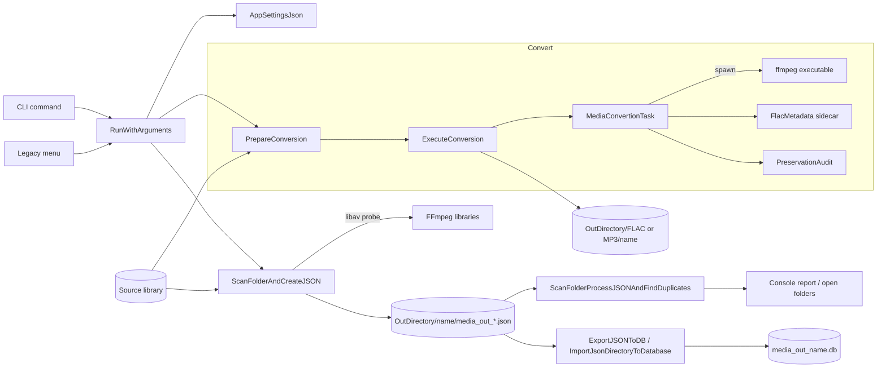

# FlacConvert design

What the application is: components, flows, contracts and file formats. Rules for changing it live in
`.github/instructions/`; the reasons behind decisions live in `docs/knowledge/` (K-xxx); user-visible features are
tracked in `docs/features/`. Code is cited as `path#Symbol`.

## Purpose

`FlacConvert` is a console utility for a local music library. It:

- converts audio to a separate output tree (16-bit / 44.1 kHz FLAC, or FLAC to MP3) without touching sources;
- scans libraries into JSON metadata batches;
- finds probable duplicate albums from those batches;
- imports the batches into a per-library SQLite database.

It runs either as explicit CLI commands or, with no arguments, as a legacy interactive menu.

## Component map

| Component | Files | Responsibility |
|---|---|---|
| Entry and orchestration | `src/FlacConvertMain.cpp` | `wmain`/`main` → `RunWithArguments`; CLI dispatch; `RunLegacyMenu` (menu, previews, `RUN` confirmation, `ManualOperationSummary`); scan, duplicate and DB-import flows |
| CLI parsing | `src/CommandLine.cpp`, `include/CommandLine.h` | `ParseCommandLine` (CLI11) → `CommandLineOptions` |
| Configuration | `src/AppSettings.cpp`, `include/AppSettings.h` | `AppSettingsJson` load/save, defaults, process-wide instance; `MediaDirectoryElement` output naming |
| Conversion options | `include/ConversionOptions.h` | `AudioTarget` (Flac/Mp3), MP3 quality, downmix flag |
| Folder conversion | `src/FolderConvert.cpp`, `include/FolderConvert.h` | `FolderConvert::PrepareConversion` (plan) and `FolderConvert::ExecuteConversion` (run, audit report, markers) |
| File conversion | `src/MediaConvertionTask.cpp`, `include/MediaConvertionTask.h` | `MediaConvertionTask`: quality gate, FFmpeg child process, output verification, sidecar, audit, installation |
| Metadata archive | `src/FlacMetadata.cpp`, `include/FlacMetadata.h` | `FlacMetadata::Save` / `FlacMetadata::Verify` byte-exact `.flac-metadata` sidecar |
| Preservation audit | `src/PreservationAudit.cpp`, `include/PreservationAudit.h` | `PreservationAudit::Compare` (tags, pictures, chapters, opaque blocks), `PreservationAudit::VerifyCopy` |
| FFmpeg library access | `src/ffmpeg.cpp`, `include/ffmpeg.h`, `include/FFmpegWrapper.h` | `FFmpeg::GetFFprobeMetadataAPI` (libav probe), audio metrics, the process-wide log callback, `FFmpeg::GetJsonMetadataShell` (ffprobe executable) |
| Track/album model | `src/MediaTrack.cpp`, `include/MediaTrack.h`, `include/MediaInformation.h`, `include/MediaAlbum.h` | `MediaTrack` (probe parsing, JSON, comparison, SQLite row), `FFprobeOutput`, `MediaAlbum` |
| Album collection | `src/AlbumCollection.cpp`, `include/AlbumCollection.h` | Discovery (`AlbumCollection::LoadAlbumsCo`), metadata import, JSON save/load, duplicate search, `AlbumCollection::ExportToDatabase` |
| Platform adapters | `src/PlatformUtils.cpp`, `include/PlatformUtils.h` | UTF-16/UTF-8, `PlatformUtils::WindowsLongPath`, `PlatformUtils::OpenDirectory` |
| Utilities | `src/CommonUtils.cpp`, `include/CommonUtils.h`, `src/JsonUtils.cpp`, `include/JsonUtils.h` | UTF-8 path helpers, coroutine `Generator`, JSON helpers |
| Legacy (unused) | `FolderConvert::ConverAudioFolder`, `FolderConvert::ConverAudioFolder2`, `MediaConvertionAsyncTask` | In-place conversion paths with no caller outside themselves; not part of any current flow |

## Data flow

## Entry points

| Mode | Entry | Notes |
|---|---|---|
| `convert <input> [--to flac\|mp3] [--mp3-quality 0-9] [--downmix-to-stereo] [--overwrite] [--output-dir]` | `RunWithArguments` → `FolderConvert::ConvertAudioFolderToOutput` | Output `<root>/<FLAC\|MP3>/<input folder name>` (K-031) |
| `scan <library> [--output-dir]` | `ScanFolderAndCreateJSON` | One library; name = folder name |
| `duplicates <json dir> [--open]` | `ScanFolderProcessJSONAndFindDuplicates` | Opens folders only with `--open` |
| `db import <json dir> [--output-dir]` | `ImportJsonDirectoryToDatabase` | Database named after the JSON folder |
| No arguments | `RunLegacyMenu` | Options 1 FLAC, 2 scan, 3 duplicates, 4 DB import, 5 not implemented, 6 MP3; all use active `MediaDirectoryList` entries |

All commands accept `--config <file>`. Exit code is 0 on success, non-zero on any failure.

## Key flows

### Conversion (menu 1/6, `convert`)

1. **Plan** – `FolderConvert::PrepareConversion` resolves input/output, rejects source/output overlap and reserved
   state names, enumerates convertible audio (`MediaTrack::IsFileConvertable`) and non-audio companions, maps each to
   `<output>/<relative path>` with a unique temporary (`.afc-convert-<pid>-<time>-<n><ext>`), and records existing
   targets and case-insensitive collisions. MP3 mode skips non-FLAC audio. Nothing is written.
2. **Preview** (menu only) – `ConvertConfiguredLibraries` plans *all* active libraries, checks cross-library overlap,
   prints `ShowConversionPreview`, and requires `RUN` (`ConfirmPreview`). Any conflict blocks the whole run (K-027).
3. **Execute** – `FolderConvert::ExecuteConversion` creates the library folder (ownership = created by this run),
   creates the `.conversion-in-progress` marker directory, then processes audio files sequentially:
   `MediaConvertionTask::Run` (convert + verify + audit) then `MediaConvertionTask::PostRun` (install). Companions are
   copied to a temporary, verified byte-for-byte (`PreservationAudit::VerifyCopy`) and installed.
4. **Finish** – re-checks every installed file and sidecar (`FlacMetadata::Verify`), writes `conversion-audit.json`,
   removes the marker. On failure the report is written, an owned folder is renamed with an error prefix, and the
   marker is retained (K-030).

Per file, `MediaConvertionTask::ConvertFile`:

1. probes the source (`FFmpeg::GetFFprobeMetadataAPI`) and rejects it below 16-bit / 44.1 kHz or if unverifiable
   (`isAtLeastCDQuality`, K-013); MP3 also requires FLAC codec and mono/stereo unless downmix is enabled (K-016);
2. rejects destinations that alias the source or pre-existing temporaries;
3. for MP3 or native FLAC sources writes and verifies the metadata sidecar to a temporary (K-015, K-028);
4. runs `ffmpeg` via `runFFmpeg` with `conversionArguments` (K-014, K-017);
5. verifies output codec, rate, depth/channels and duration (±0.15 s);
6. verifies the archive again and runs `PreservationAudit::Compare` (K-029).

`MediaConvertionTask::InstallTemporaryOutput` installs the sidecar first (backing up an existing one when
overwriting), then the audio; on audio failure it restores or removes the sidecar and leaves the temporary in place
(K-003).

### Scan to JSON (menu 2, `scan`)

`ScanFolderAndCreateJSON`: discover albums in batches of `AlbumsSplitThreshold` (`AlbumCollection::LoadAlbumsCo`),
import metadata (`AlbumCollection::ImportMetadata`, parallel when `UseAsyncFFmpegCalls`), sort by album artist, write
each batch to a staging sibling directory (`AlbumCollection::SaveAlbumsToJSON`), then `installGeneratedFiles` swaps
only `media_out_*.json` files into `OutDirectory/<mediaName>/`, with backup and rollback (K-005). An accepted audio
track with extraction/JSON errors or no usable audio stream fails the scan before installation, preserving the prior
generated JSON. The menu preview discovers albums without reading track metadata and reuses the discovered batches.

### Duplicates (menu 3, `duplicates`)

`ScanFolderProcessJSONAndFindDuplicates`: load all batches, sort by track count, `AlbumCollection::FindDuplicateAlbums`
(track count, then sorted durations / size threshold), then re-probe both source folders in parallel and print a
quality comparison (`MediaTrack::GenerateComparisonReport`). Read-only; folders are opened only when requested.

### Database import (menu 4, `db import`)

`ExportJSONToDB` (menu, per library, one transaction per JSON batch) or `ImportJsonDirectoryToDatabase` (CLI, one
transaction): `AlbumCollection::ExportToDatabase` creates `TracksDB` if needed and inserts one row per track.
Malformed album/track structure fails loading instead of silently importing a partial JSON batch. The row id is
bound as NULL, so each import **appends** rows; re-importing the same JSON duplicates them.

## Contracts and invariants

- **Sources are never modified.** Every write target is outside the source tree; overlap is rejected at plan time.
- **Install only after success.** Output is written to a unique temporary, verified and audited, then moved into place
  (`installFile`: `MoveFileExW` on Windows; rename or hard-link/copy elsewhere). Without overwrite an existing
  target is never replaced (K-003).
- **Configured paths for I/O, canonical paths for safety checks only** (K-032). Known exception:
  `ConvertConfiguredLibraries` validates each library with `fs::is_directory` on its canonical path.
- **Processing is sequential and stops at the first error**; earlier outputs remain; no batch rollback (K-024).
- **Ownership:** only library folders created by the current execution are renamed on failure (K-030).
- **Reserved names:** `conversion-audit.json` and `.conversion-in-progress` at a library root; a source containing
  them blocks the run; an existing marker in the output blocks reuse.
- **External FFmpeg tools are child processes with argument vectors**, never shell commands (K-014).
  `FFmpeg::GetJsonMetadataShell` captures ffprobe output through a pipe when `UseFFmpegLibraryAPI` is false.
- **Counts reflect confirmed work only** (installed files, installed JSON batches, committed DB batches, processed
  duplicate pairs) (K-024).

## Configuration

`AppSettingsJson::LoadForCommandLine` order: `--config` → directory persisted in `AppSettingsJsonPersistent.txt`
(current directory) → `./config.json` → built-in defaults (`AppSettingsJson::GetDefaultSettings`, no libraries). The
legacy menu uses `AppSettingsJson::AppSetting`, which can prompt for a config directory and offer to create one.

| Key | Default | Used by |
|---|---|---|
| `OutDirectory` | `C:\tmp` (Windows) / temp dir (K-007) | All outputs |
| `LogLevel` | 1 (0–6, spdlog levels) | Logger |
| `UseAsyncFFmpegCalls` | true | Parallel metadata import |
| `UseFFmpegLibraryAPI` | true | libav probe vs ffprobe executable |
| `ExtraAudioQualityMetrics` | false | Peak/RMS/dynamic range analysis |
| `MinMatchingTracksForDuplicate`, `SizeMatchPercentageThreshold` | 1, 3 | Duplicate search |
| `RecursionDirectorySearchDepth` | 10 | Discovery |
| `AlbumsSplitThreshold` | 2000 (>0) | JSON batch size |
| `FLACSettings.ffmpeg_exe_name` | `ffmpeg` | Conversion executable; the other `FLACSettings` strings are not used at runtime |
| `MediaDirectoryList[]` | – | `{ isActive, mediaPath, mediaName }`; `mediaName` must be a single directory name |

`DatabaseFileName`, `resultPath` and `dbPath` are not used for output naming.

## Files and schemas

| Artefact | Location | Writer |
|---|---|---|
| Converted audio | `<root>/FLAC\|MP3/<name>/<relative path>.flac\|.mp3` | `MediaConvertionTask` |
| Metadata sidecar | `<audio file>.flac-metadata` (MP3 and native-FLAC sources) | `FlacMetadata::Save` |
| Companion copies | Same relative path, unchanged bytes | `FolderConvert::ExecuteConversion` |
| Audit report | `<library output>/conversion-audit.json` | `writeAudit` in `FolderConvert.cpp` |
| In-progress marker | `<library output>/.conversion-in-progress/` (directory) | `FolderConvert::ExecuteConversion` |
| Album JSON | `OutDirectory/<name>/media_out_<name>[_<n>].json` | `AlbumCollection::SaveAlbumsToJSON` |
| JSON diagnostic reports | `<album json>_ffmpeg_error.json` when captured (excluded from inputs); legacy `_error.json` reports are also excluded | `AlbumCollection` |
| SQLite database | `OutDirectory/<name>/media_out_<name>.db` | `AlbumCollection::ExportToDatabase` |

**Sidecar:** original leading ID3, `fLaC` marker and every metadata block byte-for-byte, plus trailing APE/ID3v1;
no audio. Describes the source, not the output.

**`conversion-audit.json` (`schemaVersion` 1):** `source`, `output`, `target` (`FLAC`/`MP3`), `status`
(`completed`/`failed`), `errorType` (`""`, `AUDIO`, `PRESERVATION`, `COPY`, `IO`, `INCOMPLETE`), `counts`
{`plannedAudio`, `plannedCompanions`, `installedAudio`, `installedCompanions`, `skippedAudio`}, `skippedAudio[]`,
`files[]` {`source`, `output` (relative), `kind` (`audio`/`companion`), `status`
(`not-attempted`/`failed`/`audited`/`installed`), `metadataArchive`?, `preservationChecked`, `preservationPassed`,
`resources[]` {`status`, `resource`, `name`, `detail`, `fatal`}}. Resource statuses are
`PreservationAudit::Status`: `Preserved`, `Normalized`, `SidecarOnly`, `MissingOrChanged`, `NotVerified`, `SourceOnly`.

**Album JSON:** array of `{ "Album Path", "Folder", "Tracks": [ffprobe-style object with format, streams,
chapters] }`. Format and stream timing is in seconds; stream dispositions and chapter timing/tags are preserved.
The scan accepts `.flac` and `.mp3` case-insensitively and rejects the whole scan if an accepted track cannot be
serialized as usable audio metadata.

**`TracksDB`** (`MediaTrack::GetCreateTableSQL`): `ID` (`INTEGER PRIMARY KEY`, bound NULL → new rowid), `album_path`, format fields (`file_size`,
`nb_streams`, `format_name`, `start_time` and `duration` in seconds, `bit_rate`, …), one TEXT column per
`MediaTrackConstants::kFormatTag_*` (title, artist, album, album_artist, genre, track, disc, date, …), and
`stream1_*` / `stream2_*` technical columns, including stream start time in seconds.

## Threading and process lifetime

- Conversion: single thread; one synchronous FFmpeg child at a time (`_wspawnvp(_P_WAIT)` / `fork`+`execvp`+`waitpid`).
- Metadata import and duplicate comparison: one `std::async` task per track, joined before the batch is used.
- `FFmpeg::ffmpeg_log_callback` is process-wide and appends to a mutex-protected buffer.
- `AppSettingsJson::AppSetting` is a lazily created process-wide instance read from worker threads; initialise it
  before starting tasks.
- No daemon or background process outlives the command; a crash leaves the marker and temporaries for inspection.

## Error handling

Functions return `0`/`true` for success and log with spdlog; exceptions are caught at flow boundaries
(`RunWithArguments`, `RunLegacyMenu`, `FolderConvert::ExecuteConversion`) and turned into failure codes.
`PreservationAudit` uses an internal `ParseError` exception converted to `NotVerified`/fatal entries. A failed
conversion records its class in `MediaConvertionTask::GetFailureType`.

## Platform boundaries

Portable core with narrow conditional blocks (K-006). Windows-specific code: `wmain`, console code pages,
`PlatformUtils::WindowsLongPath`, `quoteWindowsArgument` + `_wspawnvp`, `MoveFileExW`, `CompareStringOrdinal`,
SQLite `win32-longpath` VFS (K-011), default `C:\tmp` (K-007). POSIX branches: `fork`/`execvp`, rename/hard-link
install, `sqlite3_open`. `JsonUtils::tryParseMember` uses the portable
`JsonUtils::caseInsensitiveEquals` helper for case-insensitive keys (K-033).

## Build and external dependencies

CMake is the shared project build (`CMakeLists.txt`, `FlacConvert/CMakeLists.txt`), with Ninja presets for native
Windows and Linux Debug/Release builds (`CMakePresets.json`). `FlacConvertCore` owns the shared implementation and
links the SQLite amalgamation, CLI11, header-only spdlog and FFmpeg; `FlacConvert` owns the executable entry point.
Windows uses MSVC and a matching shared FFmpeg SDK selected by `FFmpeg_ROOT` (default
`external/ffmpeg/ffmpeg-master-latest-win64-gpl-shared/`); CMake stages the SDK runtime DLLs beside the executable
(K-010). Linux uses pkg-config imported targets for the system FFmpeg development packages. Both platforms use the
tracked SQLite amalgamation and initialized CLI11/spdlog submodules. Runtime conversion still requires the `ffmpeg`
executable with `libmp3lame` for MP3.

`cmake --install` stages the executable; Linux links system FFmpeg libraries, while Windows installs the matched
runtime DLLs. The Windows Visual Studio solution remains a temporary fallback, not a second Linux build description.

CTest registers the Python integration suite and native preservation/warning regression tests. The native tests link
`FlacConvertCore` rather than IDE-generated object files; `tests/run_native_regression.py` creates temporary audio
fixtures using FFmpeg. `tests/mp3_conversion.py` also generates disposable fixtures. See README for presets and
prerequisites. CI uses Ubuntu 24.04 and Windows runners for Debug and Release.

## Extension points

Adding an output target (`AudioTarget` value): many sites use a binary `target == AudioTarget::Mp3 ? … : …`, so a new
value silently gets FLAC behaviour unless each site is updated:

| Concern | Site |
|---|---|
| CLI choice and option validation | `CommandLine.cpp#ParseCommandLine` |
| Output tree name (`FLAC`/`MP3`) | `FlacConvertMain.cpp#RunWithArguments`, `FlacConvertMain.cpp#ConvertConfiguredLibraries` |
| Menu entry, prompts, preview text | `FlacConvertMain.cpp#GetUserAction`, `FlacConvertMain.cpp#ConfigureManualMp3`, `FlacConvertMain.cpp#ShowConversionPreview` |
| Accepted inputs, target extension, sidecar decision | `FolderConvert.cpp#FolderConvert::PrepareConversion` |
| Audit `target` value, sidecar verification | `FolderConvert.cpp#writeAudit`, `FolderConvert.cpp#FolderConvert::ExecuteConversion` |
| Encoder arguments | `MediaConvertionTask.cpp#conversionArguments` |
| Input gate, sidecar, output verification | `MediaConvertionTask.cpp#MediaConvertionTask::ConvertFile` |
| Metadata preservation rules | `PreservationAudit.cpp#PreservationAudit::Compare` |

Adding a CLI option: `include/ConversionOptions.h#ConversionOptions`, `CommandLine.cpp#ParseCommandLine`, the menu
prompt, and `ShowConversionPreview`.

## Knowledge links

Conversion safety: K-003, K-013, K-014, K-029, K-030, K-032. Formats: K-015, K-016, K-017, K-028, K-031. Manual menu: K-024, K-025, K-026, K-027. Catalog/DB: K-005, K-011. Platform/build: K-006, K-007, K-009, K-010, K-033.
Only live entries are listed; superseded history is in `docs/knowledge/index.md` under "Closed".
